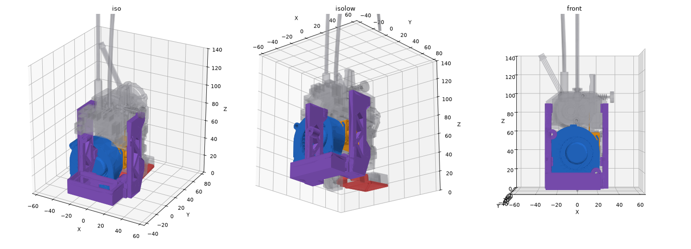

# SV08 minimal 5020 fan holder

A minimal replacement for the Sovol SV08's blue front toolhead cover. It holds only the stock 5020 part-cooling blower and its duct. The hotend, heatsink fan and probe stay fully open.

It replaces the stock blue cover, the stock 5020 duct (JXHSV08-06029) and its cover plate (JXHSV08-06032). The rear 3010 blower and its deflector stay as they are.



## Design
- **Fan:** the stock 5020 sits in its original position, with its outlet dropping into a socket on the duct.
- **Duct:** feeds three jets aimed just below the nozzle tip, from the front, front-left and front-right. The rear 3010 covers the back. The duct's underside is 3.6 mm above the tip, the same as stock.
- **Mounting:** four magnets in the stock positions. The pads are shaped around the raised rims and screw heads on the extruder plate, so they key on the same way as the stock cover.
- **Frame:** two side cheeks, each about 21 mm deep, run from the duct floor up to the upper magnet pads. They fill the empty space between the fan and the extruder plate. Diagonal ribs with triangular cut-outs between them keep the weight down. Compared with the earlier 5×6 mm rails, a cheek is about 10× stiffer against being pulled off the magnets and about 2.5× stiffer sideways. The upper-left fan boss is built into the left cheek, and both bosses are 10 mm across.
- Modeled and collision-checked against Sovol's published hotend STEP (`JXHSV08-06000`, [Sovol3d/SV08](https://github.com/Sovol3d/SV08)).

## Hardware
- Stock 5020 blower
- 2× M3×30 socket head screws, through the fan ears from the front, self-tapping into the bosses
- 4× 4×3 mm disc magnets. Check polarity against the toolhead before gluing.

## Printing
- Print upright, standing on the duct floor. No supports needed.
- ASA or ABS. The part sits right over the heated bed, so PLA will sag.
- 4 walls. This makes the cheek flanges and ribs print essentially solid. Print in an enclosure so the layers bond well.
- The part is about 25 cm³ (about 27 g in ASA).
- Drive the fan screws until they're snug and stop there. Overtightening a self-tapping screw can split the boss along a layer line.

## Notes
- Modeled with the stock inductive probe. If you use an Eddy probe, check the clearance on the left side.
- With the open front, part cooling is stronger than stock. Re-check your fan percentages.

## Files
| File | What it is |
|---|---|
| `sv08_5020_fan_holder.stl` | Ready to slice |
| `sv08_5020_fan_holder.step` | For editing in Fusion, Onshape, FreeCAD, etc. |
| `sv08_5020_fan_holder.py` | Parametric CadQuery source |
| `preview.png` | Render on the stock toolhead |

## Rebuilding from source
CadQuery needs Python 3.10–3.13 (its OCP dependency has no 3.14 wheels yet).
```
python3.13 -m venv .venv
.venv/Scripts/python -m pip install -r requirements.txt     # .venv/bin/python on Linux/macOS
.venv/Scripts/python sv08_5020_fan_holder.py sv08_5020_fan_holder path/to/hotend.step
```
The STEP argument is optional. It's Sovol's hotend assembly, used to carve clearance around the extruder plate, screw heads and fan ear. All dimensions are parameters at the top of the script. The origin is the nozzle tip, +Y points toward the back of the printer, and +Z points up.
